 

 

  

  

---

## `01 / ABOUT ME`

I'm a **Python Backend Engineer** interested in building reliable, maintainable software systems.

I work with Python, FastAPI, Django REST Framework, PostgreSQL, and SQL to develop backend services, REST APIs, business logic, and database-driven applications.

At **BitCoding Solutions**, I've contributed to backend systems across property-auction, warehouse-management, and e-commerce applications. My work includes API development, database operations, production debugging, and backend maintenance.

Alongside my professional work, I build independent projects around **API engineering, AI/LLM applications, Retrieval-Augmented Generation (RAG), and agent-based systems**.

I'm particularly interested in understanding how systems work internally, solving engineering problems, and building software that remains reliable as it grows.

## `02 / TECH STACK`

**BACKEND DEVELOPMENT**

**DATABASES & STORAGE**

**TOOLS & INFRASTRUCTURE**

**AI & MACHINE LEARNING**

## `03 / PROFESSIONAL EXPERIENCE`

### Python Developer - BitCoding Solutions Pvt. Ltd.

`July 2025 - Present`

- Worked on backend development across property-auction, warehouse-management, and e-commerce applications.
- Developed and maintained REST APIs using Python, FastAPI, Django, and Django REST Framework.
- Worked with PostgreSQL and MySQL for database operations, schema changes, migrations, and SQL investigations.
- Took ownership of backend development and maintenance for a property-auction platform.
- Investigated production issues using application behaviour, server logs, API responses, and database records.
- Built database backup scripts and SQL utilities for warehouse-management workflows.

### AI/ML Intern - Sparks To Ideas

`February 2025 - March 2025`

- Worked with Pandas and NumPy for data preparation and feature engineering.
- Explored supervised machine-learning workflows and model evaluation.

## `04 / SELECTED PROJECTS`

Projects focused on backend engineering, API development, and applied AI.

| Project | Technologies & Focus |
|---|---|
| **ApiWall** | FastAPI, PostgreSQL, Redis, API security and monitoring |
| **InvenIO** | FastAPI, PostgreSQL, marketplace workflows and semantic search |
| **Document Intelligence** | Document processing, RAG, embeddings and source-based Q&A |
| **Healthcare AI Assistant** | LLMs, RAG, embeddings and vector search |
| **RLM Agent Framework** | DSPy, agent orchestration and programmatic reasoning |

## `05 / EDUCATION`

**B.E. - Computer Engineering**

Pacific School of Engineering, Gujarat Technological University

`2022 - 2026`

<badge-placeholder></badge-placeholder>

**CGPA: 9.46 / 10**

## `06 / ACHIEVEMENTS`

- SAP Code Unnati - Semifinalist
- First Rank - Semester 7
- First Rank - Fourth Year
- Second Rank - Semester 3

## `07 / CONTRIBUTION ACTIVITY`

<picture>
  <source media="(prefers-color-scheme: dark)" srcset="https://raw.githubusercontent.com/ganesh-rajput-07/ganesh-rajput-07/output/github-contribution-grid-snake-dark.svg" />
  <source media="(prefers-color-scheme: light)" srcset="https://raw.githubusercontent.com/ganesh-rajput-07/ganesh-rajput-07/output/github-contribution-grid-snake.svg" />
  
</picture>

  

 

---

### `$ ./connect.sh`

  

Building reliable systems. Learning continuously. Engineering with purpose.

