 

 

 

## `$ whoami`

I'm a **Python Backend Engineer** interested in building reliable, maintainable software systems.

I work with Python, FastAPI, Django REST Framework, PostgreSQL, and SQL to develop backend services, REST APIs, business logic, and database-driven applications.

At **BitCoding Solutions**, I've contributed to backend systems across property-auction, warehouse-management, and e-commerce applications. My work includes API development, database operations, production debugging, and backend maintenance.

Alongside my professional work, I build independent projects around **API engineering, AI/LLM applications, Retrieval-Augmented Generation (RAG), and agent-based systems**.

I'm particularly interested in understanding how systems work internally, solving engineering problems, and building software that remains reliable as it grows.

## `$ tech --stack`

| Area | Technologies |
|---|---|
| Languages | Python, SQL, Java |
| Backend | FastAPI, Django, Django REST Framework, Flask, Pydantic |
| Databases | PostgreSQL, MySQL, SQLite, Redis |
| API Engineering | REST APIs, JWT, RBAC, OpenAPI, API Security |
| Testing | Pytest, Unit Testing, Integration Testing, Postman |
| Tools & Infrastructure | Linux, Docker, Git, GitHub Actions |
| AI & LLM | RAG, Embeddings, Vector Search, LangChain, DSPy |
| AI Ecosystem | FAISS, ChromaDB, Hugging Face, Gemini, Groq, OpenRouter |
| Data & ML | Pandas, NumPy, Feature Engineering, Supervised Learning |

 

## `$ experience --professional`

**Python Developer - BitCoding Solutions Pvt. Ltd.**

`July 2025 - Present`

- Worked on backend development across property-auction, warehouse-management, and e-commerce applications.
- Developed and maintained REST APIs using Python, FastAPI, Django, and Django REST Framework.
- Worked with PostgreSQL and MySQL for database operations, schema changes, migrations, and SQL investigations.
- Took ownership of backend development and maintenance for a property-auction platform.
- Investigated production issues using application behaviour, server logs, API responses, and database records.
- Built database backup scripts and SQL utilities for warehouse-management workflows.

**AI/ML Intern - Sparks To Ideas**

`February 2025 - March 2025`

- Worked with Pandas and NumPy for data preparation and feature engineering.
- Explored supervised machine-learning workflows and model evaluation.

## `$ ls ./selected-projects`

A selection of projects exploring backend engineering and applied AI.

| Project | Focus |
|---|---|
| **ApiWall** | API security, authentication, access control, rate limiting, and monitoring |
| **InvenIO** | FastAPI, PostgreSQL, marketplace workflows, and semantic search |
| **Document Intelligence** | Document processing, RAG, embeddings, and source-based question answering |
| **Healthcare AI Assistant** | RAG-based question answering using LLMs and vector search |
| **RLM Agent Framework** | Agent orchestration and programmatic reasoning workflows |

*Explore the pinned repositories below for source code, implementation details, and setup instructions.*

## `$ education`

**B.E. - Computer Engineering**

Pacific School of Engineering, Gujarat Technological University

`2022 - 2026` | **CGPA: 9.46 / 10**

## `$ achievements`

- SAP Code Unnati - Semifinalist
- First Rank - Semester 7
- First Rank - Fourth Year
- Second Rank - Semester 3

 

## `$ git log --graph --all`

<picture>
  <source media="(prefers-color-scheme: dark)" srcset="https://raw.githubusercontent.com/ganesh-rajput-07/ganesh-rajput-07/output/github-contribution-grid-snake-dark.svg" />
  <source media="(prefers-color-scheme: light)" srcset="https://raw.githubusercontent.com/ganesh-rajput-07/ganesh-rajput-07/output/github-contribution-grid-snake.svg" />
  
</picture>

 

  

### `$ ./connect.sh`

  

Strong systems survive scale. Good engineering survives time.

